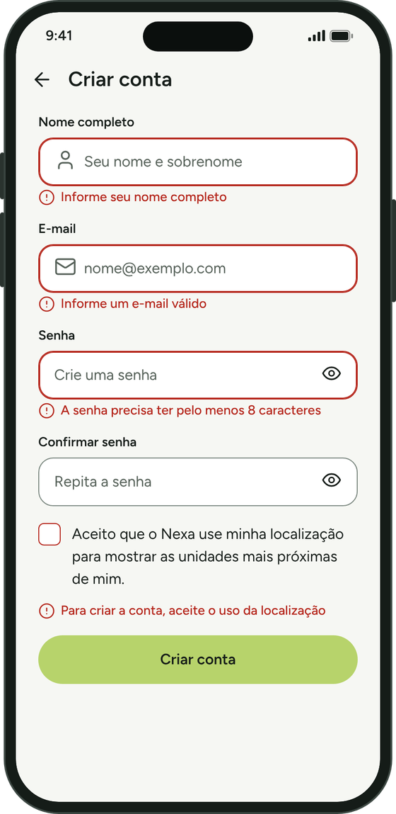
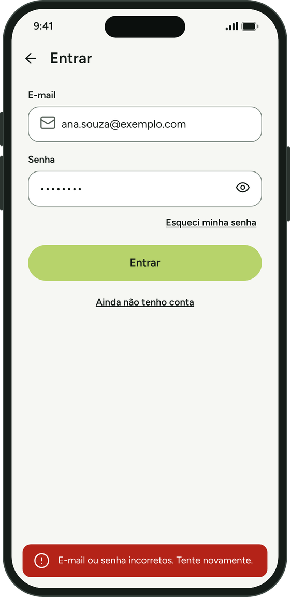
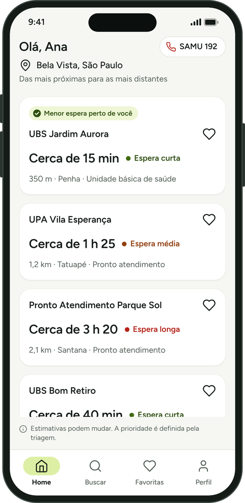
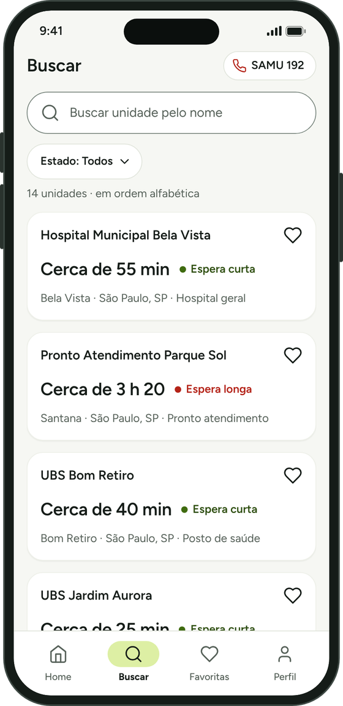
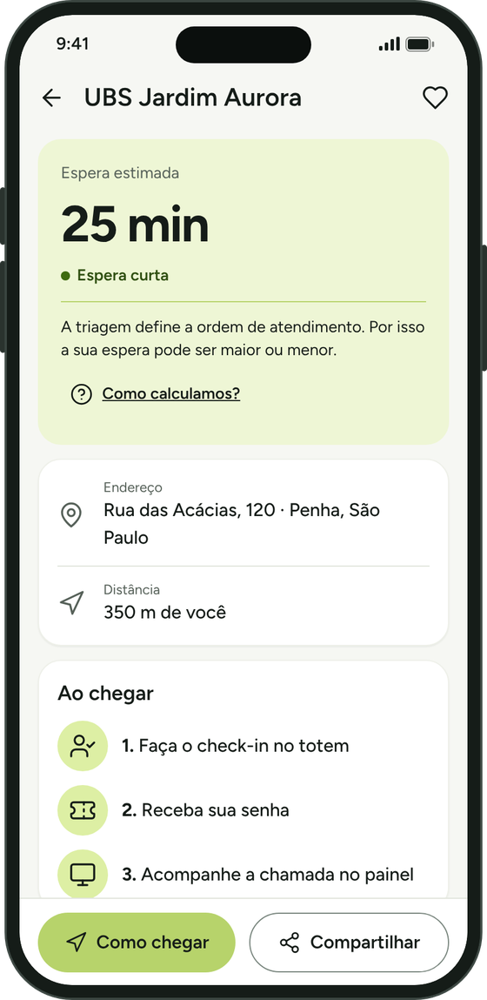
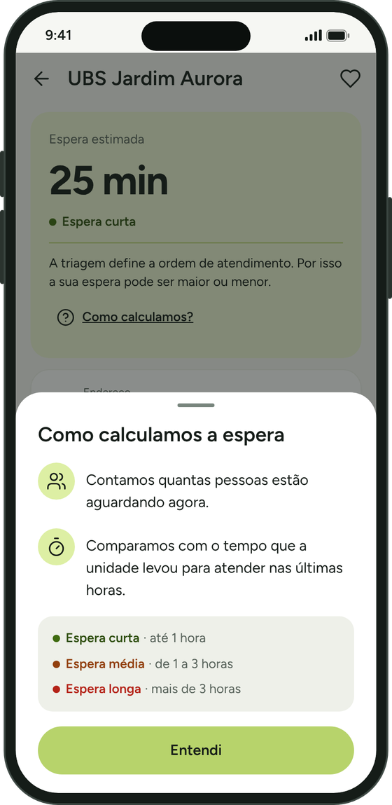
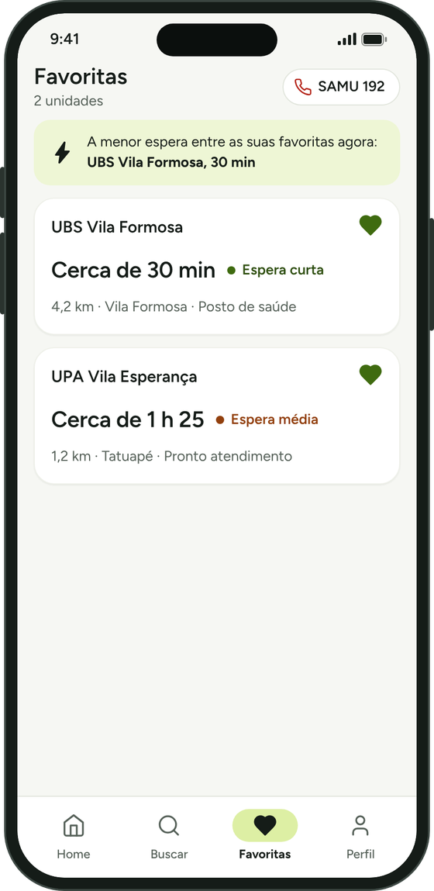

# 🏥 Nexa (CitizenTech) — Gestão Inteligente de Filas e Atendimentos no SUS

API RESTful desenvolvida em **Java 21** e **Spring Boot** para a **Global Solution FIAP**, projetada para otimizar o fluxo de atendimento, direcionamento inteligente de cidadãos e acompanhamento dinâmico de filas nas Unidades de Saúde Públicas (SUS/CNES).

A plataforma integra **geolocalização de alta precisão** (*ViaCEP* + *Google Geocoding API* + cálculo espacial via **Fórmula de Haversine** com *Bounding Box* sobre banco relacional normalizado em **3FN**), **motor de filas FIFO por serviço com geração de senhas sequenciais e chamada/promoção automáticas**, **criação de conta de usuário com consentimento explícito LGPD**, **filtros dinâmicos com Query by Example**, **navegação hipermídia (HATEOAS)**, **cacheamento em memória (`@Cacheable` / `@CacheEvict`)**, **observabilidade (Actuator)** e **autenticação stateless via Bearer JWT**.

---

## 🎬 Vídeo Pitch

<p align="center">
  <a href="https://youtu.be/CeRqUdq_1lY">
    
  </a>
  <br>
  <a href="https://youtu.be/CeRqUdq_1lY"><b>▶️ Assistir ao pitch do Nexa no YouTube</b></a>
</p>

O pitch mostra o problema da espera no SUS, a solução, a demonstração do app em funcionamento com esta API, o modelo de negócio e o impacto esperado.

---

## 📱 Integração com o App Nexa (Flutter)

Esta API é o backend do aplicativo **Nexa**, feito em Flutter e mantido no repositório [`fe-nexa-app`](https://github.com/NexaGS/fe-nexa-app). Abaixo, as telas do app e o endpoint que cada uma consome.

| Tela do app | Endpoint consumido |
| :--- | :--- |
| Criar conta (com consentimento LGPD) | `POST /api/auth/registro` |
| Entrar | `POST /api/auth/login` |
| Início (unidades perto de você) | `GET /api/unidades/proximas` e `GET /api/localizacoes/reversa` |
| Buscar | `GET /api/unidades` (filtros `nome` e `uf`) |
| Detalhe da unidade | `GET /api/unidades/{id}` |
| Favoritas | `GET /api/cidadaos/usuario/favoritas`, `PUT /api/cidadaos/usuario/adicionarUnidade/{id}` e `DELETE /api/cidadaos/usuario/removerUnidade/{id}` |

O app consulta a API de novo a cada 20 segundos (30 na tela Buscar) para manter as informações atualizadas sem o usuário precisar puxar a tela.

<p align="center">
  
  
  
  
</p>
<p align="center">
  
  
  
</p>

> As imagens foram tiradas a partir de emuladores durante o desenvolvimento da solução.

---

## 👨‍💻 Integrantes do Grupo

| Nome Completo | RM |
| :--- | :--- |
| **Paulo Cavalcante Caroba** | `RM566667` |
| **Renan da Silva Paulino** | `RM566610` |
| **Sergio Henrique da Silva Santos** | `RM567254` |

---

## 🛠️ Stack Tecnológica & Pré-requisitos

### Tecnologias Utilizadas
- **Linguagem:** Java 21 (LTS)
- **Framework:** Spring Boot `4.1.2` (`spring-boot-starter-webmvc`)
- **Persistência & ORM:** Spring Data JPA / Hibernate (Modelagem em **3ª Forma Normal - 3FN** compatível com códigos oficiais IBGE e estabelecimentos CNES/SUS)
- **Consultas Avançadas:** Derived Queries, JPQL customizado (`JOIN FETCH` + Haversine) e **Query by Example (`ExampleMatcher`)**
- **Bancos de Dados Suportados:** H2 Database (em memória para execução imediata) e Oracle Database (`ojdbc11`)
- **Segurança:** Spring Security 6 + Autenticação Stateless **JWT (`jjwt 0.13.0`)** com perfis `ROLE_COLABORADOR` e `ROLE_USUARIO` + Criptografia **BCrypt**
- **Hipermídia:** Spring HATEOAS (`EntityModel`, `RepresentationModelAssembler`)
- **Performance & Cache:** Spring Cache (`@EnableCaching`, `@Cacheable`, `@CacheEvict`) com sincronização automática nas alterações de estado
- **Validação & Tratamento de Falhas:** Jakarta Bean Validation (`@Valid`, anotação `@CepValido` customizada) + `@RestControllerAdvice` (`GlobalExceptionHandler`)
- **Clientes HTTP:** Spring `RestClient` nativo com timeouts configurados (ViaCEP API & Google Geocoding API)
- **Observabilidade:** Spring Boot Actuator (`/actuator/health`, `/actuator/info`, `/actuator/metrics`)
- **Documentação da API:** Springdoc OpenAPI 3 (`springdoc-openapi-starter-webmvc-ui:3.2.0`) + **Swagger UI** + **Redoc / Redocly** com agrupamento hierárquico (`x-tagGroups`)

### Pré-requisitos para Execução
- **JDK 21** instalado e configurado no `PATH` (`JAVA_HOME`)
- **Maven 3.9+** (opcional — o repositório inclui o wrapper executável `./mvnw` / `mvnw.cmd`)
- **Node.js 18+** (opcional — necessário apenas para execução via CLI externa do `@redocly/cli`)

---

## 🚀 Como Executar Localmente

### 1. Clonar o Repositório
```bash
git clone <URL_DO_REPOSITORIO>
cd gs-springboot
```

### 2. Configuração de Ambiente (Opcional — H2 com Carga Automática)
Por padrão, a aplicação inicia utilizando o banco em memória **H2** (`spring.profiles.active: h2`), carregando automaticamente massa de dados fictícia pronta para testes via [`DataInitializer`](src/main/java/br/com/gs/springboot/gs_springboot/config/DataInitializer.java).

Caso deseje executar apontando para o banco **Oracle** ou integrar sua chave da Google Geocoding, configure as variáveis em um arquivo `.env` na raiz (baseado no `.env.exemplo`):

```properties
# Seleção de banco: h2 (padrão) ou oracle
SPRING_PROFILES_ACTIVE=h2

# Segurança JWT
JWT_SECRET=cHJvamVjdG1ndC1kZXYtc2VjcmV0LWtleS0zMmJ5dGU
ADMIN_EMAIL=admin@nexa.com
ADMIN_PASSWORD=admin123

# Integração Google Maps Geocoding API
GOOGLE_API_KEY=sua_chave_google_maps_aqui

# Banco de Dados Oracle (quando SPRING_PROFILES_ACTIVE=oracle)
DB_URL=jdbc:oracle:thin:@oracle.fiap.com.br:1521:ORCL
DB_USUARIO=rmXXXXXX
DB_SENHA=sua_senha
```

### 3. Compilar e Executar

**No Windows (PowerShell / CMD):**
```powershell
.\mvnw.cmd clean compile
.\mvnw.cmd spring-boot:run
```

**No Linux / macOS:**
```bash
./mvnw clean compile
./mvnw spring-boot:run
```

A API estará disponível no endereço: **`http://localhost:8080`**

---

## 🧪 Dados Pré-Carregados para Demonstração (`DataInitializer`)

Ao subir com o perfil `h2`, o sistema popula automaticamente dados iniciais para validação ponta a ponta dos fluxos:

- **Colaborador / Administrador Cadastrado:**
  - **E-mail:** `admin@nexa.com`
  - **Senha:** `admin123`
  - **Perfil:** `ROLE_COLABORADOR` (acesso liberado a `POST /api/colaboradores` e `PUT /api/atendimentos/{id}/encerramento`)
- **Unidades de Saúde Prontas:**
  - `ID 1`: **UBS Bela Vista - Paulista** (Avenida Paulista, 1100 - São Paulo/SP)
  - `ID 2`: **UPA Vila Mariana** (Rua Domingos de Morais, 800 - São Paulo/SP)
- **Pacientes Cadastrados para Check-in:**
  - `12345678901` (Carlos Eduardo Silva)
  - `98765432100` (Maria Oliveira Santos)
  - `11122233344` (João Pedro Pereira)

---

## 📚 Acesso à Documentação (OpenAPI 3, Swagger UI & Redocly)

Com a aplicação em execução na porta `8080`, acesse os canais de documentação:

| Interface | URL / Comando | Finalidade |
| :--- | :--- | :--- |
| **Swagger UI (Interativo)** | [`http://localhost:8080/swagger-ui/index.html`](http://localhost:8080/swagger-ui/index.html) | Execução interativa dos endpoints, envio de payloads de teste e autenticação com token no botão **Authorize**. |
| **Redoc Integrado (Portal Web)** | [`http://localhost:8080/docs.html`](http://localhost:8080/docs.html) | Interface moderna e responsiva de documentação técnica com navegação em barra lateral hierárquica baseada em `x-tagGroups`. |
| **OpenAPI 3 Spec (JSON)** | [`http://localhost:8080/v3/api-docs`](http://localhost:8080/v3/api-docs) | Especificação bruta JSON no padrão OpenAPI 3.0/3.1 consumida dinamicamente pelas ferramentas. |
| **OpenAPI 3 Spec (YAML)** | [`http://localhost:8080/v3/api-docs.yaml`](http://localhost:8080/v3/api-docs.yaml) | Especificação no formato YAML para linting ou exportação. |

### Renderização e Validação via Redocly CLI
A especificação OpenAPI gerada é 100% compatível com a suíte de ferramentas do **Redocly**:

```bash
# Pré-visualização ao vivo da documentação OpenAPI com o servidor do Redocly
npx @redocly/cli preview-docs http://localhost:8080/v3/api-docs --port 8081

# Validação estática e linting das regras de contrato OpenAPI
npx @redocly/cli lint http://localhost:8080/v3/api-docs

# Compilação para um único arquivo HTML estático independente
npx @redocly/cli build-docs http://localhost:8080/v3/api-docs -o target/redoc-static.html
```

---

## 🗺️ Tabela de Endpoints da API

### 1. Segurança & Acesso (`Autenticação` / `Colaboradores`)

| Método | Rota | Autenticação | Resumo da Operação | Status HTTP |
| :---: | :--- | :---: | :--- | :--- |
| `POST` | `/api/auth/registro` | 🔓 Público | Cria uma nova conta de usuário comum com consentimento obrigatório para uso de geolocalização (LGPD) e retorna o token JWT. | `201`, `400`, `409`, `500` |
| `POST` | `/api/auth/login` | 🔓 Público | Autentica usuários comuns ou colaboradores via e-mail e senha, emitindo token **Bearer JWT** com a respectiva role (`USUARIO` ou `COLABORADOR`). | `200`, `400`, `401`, `500` |
| `POST` | `/api/colaboradores` | 🔒 `ROLE_COLABORADOR` | Cadastra um novo profissional de saúde vinculado a uma unidade com senha criptografada em BCrypt. | `201`, `400`, `401`, `403`, `404`, `409`, `500` |

### 2. Jornada do Cidadão & Triagem (`Unidades de Saúde` / `Atendimentos`)

| Método | Rota | Autenticação | Resumo da Operação | Status HTTP |
| :---: | :--- | :---: | :--- | :--- |
| `GET` | `/api/unidades` | 🔓 Público | Lista unidades de saúde com paginação, cache (`@Cacheable("unidades")`) e **filtros dinâmicos opcionais por Query by Example** (`?nome=...&tipoUnidade=...`). | `200`, `400`, `500` |
| `GET` | `/api/unidades/{id}` | 🔓 Público | Consulta detalhes de uma unidade por ID com links hipermídia **HATEOAS** (`self`, `unidades`). | `200`, `400`, `404`, `500` |
| `GET` | `/api/unidades/proximas` | 🔓 Público | Busca unidades de saúde ordenadas por proximidade geográfica (**Fórmula de Haversine + Bounding Box**) informando GPS (`latitude`/`longitude`) ou endereço/CEP (`entradaEndereco`). | `200`, `400`, `404`, `500` |
| `POST` | `/api/atendimentos/checkIn` | 🔓 Público | Realiza o check-in do paciente por CPF, unidade e serviço (`CLINICO_GERAL`, `VACINACAO`, `TRIAGEM`, etc.), gerando **senha sequencial formatada** (ex.: `CLI-001`), promovendo a `CHAMADO` se a fila estiver livre ou enfileirando como `AGUARDANDO`. | `201`, `400`, `404`, `500` |
| `GET` | `/api/atendimentos/{id}` | 🔓 Público | Consulta o status do atendimento, senha emitida, posição em tempo real na fila, tempo estimado de espera e link HATEOAS para encerramento (`encerrar`). | `200`, `400`, `404`, `500` |
| `GET` | `/api/atendimentos/unidades/{unidadeId}` | 🔒 `Bearer JWT` | Lista paginada dos atendimentos em andamento da unidade (`CHAMADO` e `AGUARDANDO`), ordenados cronologicamente por hora de chegada (FIFO). | `200`, `400`, `401`, `500` |
| `PUT` | `/api/atendimentos/{id}/encerramento` | 🔒 `ROLE_COLABORADOR` | Finaliza o atendimento (`FINALIZADO`), registra `horaFim`, vincula o colaborador autenticado, **promove automaticamente o próximo paciente `AGUARDANDO` para `CHAMADO`** e invalida os caches. | `200`, `401`, `403`, `404`, `422`, `500` |

### 3. Observabilidade & Monitoramento (`Actuator`)

| Método | Rota | Autenticação | Resumo da Operação |
| :---: | :--- | :---: | :--- |
| `GET` | `/actuator/health` | 🔓 Público | Verifica a integridade da aplicação, conexão com o banco de dados (`db`) e espaço em disco. |
| `GET` | `/actuator/info` | 🔓 Público | Apresenta metadados informativos da aplicação. |
| `GET` | `/actuator/metrics` | 🔓 Público | Expõe métricas de performance coletadas pelo Micrometer (JVM, pool de conexões e requisições HTTP). |

---

## 🔄 Roteiro de Teste do Fluxo de Atendimento no Swagger UI

Para testar a inteligência da fila FIFO e o encerramento com promoção automática:

1. Acesse o **Swagger UI** em [`http://localhost:8080/swagger-ui/index.html`](http://localhost:8080/swagger-ui/index.html).
2. Execute o **1º Check-in** em `POST /api/atendimentos/checkIn`:
   ```json
   {
     "idUnidade": 1,
     "cpf": "12345678901",
     "servico": "CLINICO_GERAL"
   }
   ```
   *Resultado:* Retorna senha `CLI-001` com status `CHAMADO` (`posicaoFila: 0`, `tempoEsperaMinutos: 0.0`) pois o guichê estava livre.
3. Execute o **2º Check-in** em `POST /api/atendimentos/checkIn` na mesma unidade e serviço:
   ```json
   {
     "idUnidade": 1,
     "cpf": "98765432100",
     "servico": "CLINICO_GERAL"
   }
   ```
   *Resultado:* Retorna senha `CLI-002` com status `AGUARDANDO` (`posicaoFila: 1`, `tempoEsperaMinutos: 20.0`).
4. Realize a **Autenticação** em `POST /api/auth/login` enviando `{"email": "admin@nexa.com", "senha": "admin123"}`. Copie o valor do `token` retornado, clique em **Authorize** no topo do Swagger UI e cole o token.
5. Execute o **Encerramento** do primeiro atendimento em `PUT /api/atendimentos/1/encerramento`. O status do atendimento 1 passa para `FINALIZADO` com o colaborador associado.
6. Consulte o segundo atendimento em `GET /api/atendimentos/2`. Observe que o paciente `CLI-002` foi **promovido automaticamente para `CHAMADO`** (`posicaoFila: 0`, `tempoEsperaMinutos: 0.0`)!
