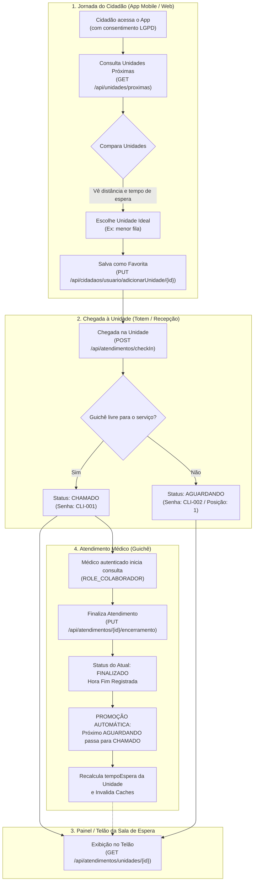
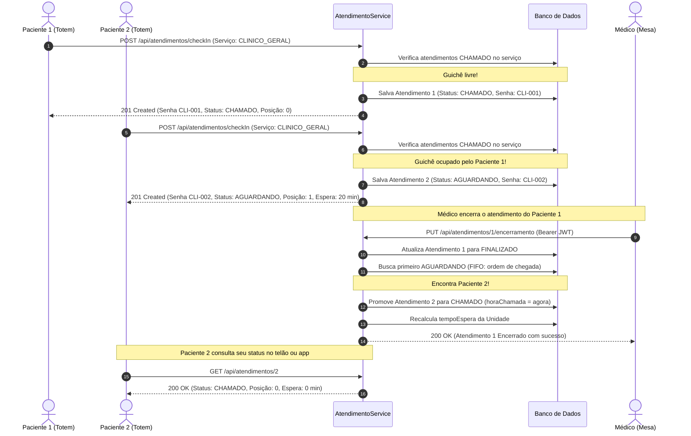
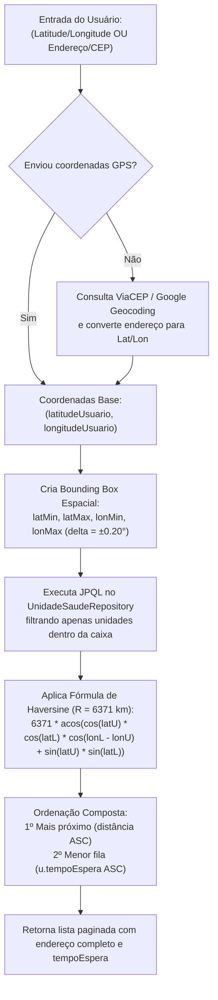
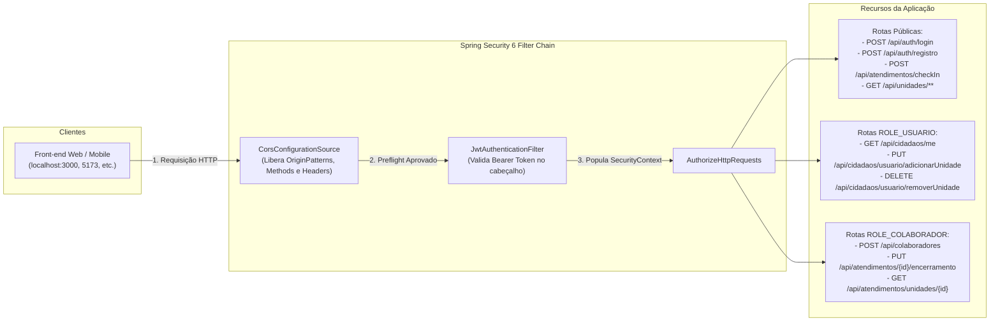

# 🏥 Nexa (CitizenTech) — Gestão Inteligente de Filas e Atendimentos no SUS
## Resumo Executivo da Arquitetura, Regras de Negócio e Fluxos do MVP

> **Global Solution FIAP 2026 — Java Advanced & Smart Cities**  
> **Integrantes:**  
> - Paulo Cavalcante Caroba (`RM566667`)  
> - Renan da Silva Paulino (`RM566610`)  
> - Sergio Henrique da Silva Santos (`RM567254`)  

---

## 📌 1. Visão Geral da Solução (Cidade Tech & SUS)

O **Nexa** é uma solução de **Smart Healthcare** projetada para sanar uma das maiores dores da atenção básica no Sistema Único de Saúde (SUS): o **desbalanceamento da demanda entre unidades públicas de saúde**. 

Enquanto uma Unidade Básica de Saúde (UBS) enfrenta superlotação, outra unidade a poucos quilômetros pode estar com guichês ociosos. O Nexa conecta o cidadão e as equipes de saúde por meio de:
1. **Roteamento Geoespacial Inteligente:** Calcula a distância real do cidadão até as unidades mais próximas (**Fórmula de Haversine** com *Bounding Box*), priorizando proximidade física e menor tempo de espera.
2. **Motor de Filas FIFO Dinâmico:** Emissão de senhas padronizadas por especialidade médica, chamada imediata em guichês vagos e **promoção automática** do próximo paciente quando um atendimento é encerrado.
3. **Conformidade com a LGPD:** Registro com consentimento explícito e auditável para uso de geolocalização.
4. **Prontidão para Front-End Multiplataforma:** API RESTful stateless em Spring Boot com CORS habilitado, paginação padronizada (`PageResponse`) e hipermídia (**Spring HATEOAS**).

---

## 🔄 2. Desenhos de Fluxo Explicativos

### 2.1. Fluxo Geral da Jornada do Usuário (Ponta a Ponta)

---

### 2.2. Fluxo Detalhado do Motor de Filas FIFO & Promoção Automática

---

### 2.3. Fluxo do Algoritmo de Busca Geoespacial (Haversine + Desempate por Fila)

---

### 2.4. Fluxo de Segurança, Autenticação e CORS

---

## 📋 3. Matriz de Endpoints do MVP

| Módulo | Método | Endpoint | Acesso | Descrição Funcional |
| :--- | :---: | :--- | :---: | :--- |
| **Autenticação** | `POST` | `/api/auth/registro` | 🔓 Público | Cria conta com consentimento LGPD e emite JWT. |
| **Autenticação** | `POST` | `/api/auth/login` | 🔓 Público | Autentica `USUARIO` ou `COLABORADOR` e emite JWT. |
| **Cidadão** | `GET` | `/api/cidadaos/me` | 🔒 Usuário | Retorna os dados do próprio cidadão logado com HATEOAS. |
| **Cidadão** | `PUT` | `/api/cidadaos/usuario/adicionarUnidade/{unidadeId}` | 🔒 Usuário | Adiciona unidade de saúde à lista de favoritas do usuário. |
| **Cidadão** | `DELETE` | `/api/cidadaos/usuario/removerUnidade/{unidadeId}` | 🔒 Usuário | Remove unidade de saúde das favoritas do usuário. |
| **Unidades** | `GET` | `/api/unidades` | 🔓 Público | Catálogo paginado com cache e filtro por Query by Example. |
| **Unidades** | `GET` | `/api/unidades/{id}` | 🔓 Público | Detalhes de uma unidade específica com HATEOAS. |
| **Unidades** | `GET` | `/api/unidades/proximas` | 🔓 Público | Busca geoespacial ordenada por proximidade e menor fila. |
| **Atendimentos** | `POST` | `/api/atendimentos/checkIn` | 🔓 Público | Check-in por CPF e especialidade; emite senha sequencial. |
| **Atendimentos** | `GET` | `/api/atendimentos/{id}` | 🔓 Público | Consulta status, posição na fila e tempo estimado. |
| **Atendimentos** | `GET` | `/api/atendimentos/unidades/{unidadeId}` | 🔒 Autenticado | Telão da unidade com fila ativa ordenada por chegada (FIFO). |
| **Atendimentos** | `PUT` | `/api/atendimentos/{id}/encerramento` | 🔒 Colaborador | Finaliza consulta e promove o próximo da fila para CHAMADO. |

---

## 🎯 4. Roteiro Prático de Demonstração (Para a Apresentação na FIAP)

Para uma apresentação ágil e impactante (5 a 8 minutos):

1. **Apresentar a Inteligência de Proximidade (Swagger ou Front):**
   - Executar `GET /api/unidades/proximas?latitude=-23.563&longitude=-46.654`.
   - Mostrar que as unidades retornam ordenadas pela distância e exibem o campo `tempoEspera`.
2. **Demonstrar a Criação de Conta do Cidadão:**
   - Executar `POST /api/auth/registro` demonstrando o aceite explícito de geolocalização (`aceitouLocalizacao = true`).
   - Consultar `GET /api/cidadaos/me` enviando o token gerado.
3. **Simular a Fila em Tempo Real (O Ponto Alto do Pitch):**
   - **Check-in 1:** Fazer check-in do Carlos (`POST /api/atendimentos/checkIn`) na UBS 1. Retorna senha `CLI-001` com status `CHAMADO` (guichê vago).
   - **Check-in 2:** Fazer check-in da Maria na mesma UBS. Retorna senha `CLI-002` com status `AGUARDANDO`, `posicaoFila: 1` e `tempoEsperaMinutos: 20.0`.
   - **Login do Médico:** Fazer login com `admin@nexa.com` e copiar o token `ROLE_COLABORADOR`.
   - **Encerramento:** Encerrar o atendimento 1 (`PUT /api/atendimentos/1/encerramento`).
   - **Promoção Automática:** Consultar o atendimento 2 (`GET /api/atendimentos/2`). Mostrar que a Maria foi **automaticamente promovida para `CHAMADO`** (`posicaoFila: 0`).
4. **Encerramento Técnico:**
   - Mostrar a documentação viva em `/swagger-ui/index.html` e `/docs.html` (Redocly) e o `/actuator/health`.
